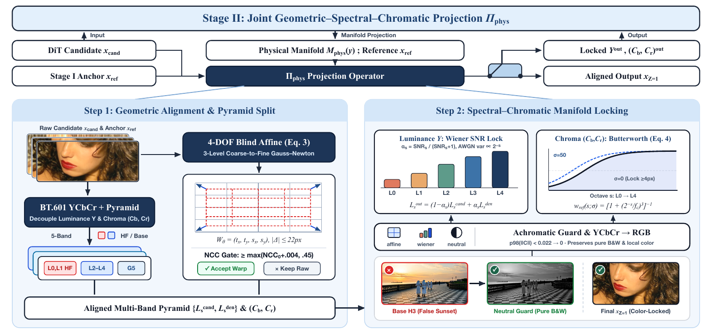

<div align="center">

# RestoreH3: Physics-Guided Blind All-in-One Image Restoration with MiniMax-H3-Image

**Zihao He** &nbsp;·&nbsp; **Songhua Liu**<sup>*</sup>

School of Artificial Intelligence, Shanghai Jiao Tong University  
<sup>*</sup>Corresponding author: `liusonghua@sjtu.edu.cn`

[](LICENSE)
[](pyproject.toml)
[-0F766E.svg)](https://github.com/RedRoman/RestoreH3/releases/tag/v1.0.0)
[](tests/test_restoreh3_cpu.py)

</div>

<p align="center">
  
</p>

## Overview

Off-the-shelf unified omni-image foundation models such as 33B **`MiniMax-H3-Image`** synthesize sharp textures yet collapse in pixel and structural fidelity (16.66 dB PSNR across 497 standard public scenes) when applied blindly to all-in-one image restoration due to **spatial zoom/lattice drift**, **mid-band chromatic hallucination**, and **high-entropy text fabrication**.

**RestoreH3** formulates blind all-in-one restoration as **Three-Stage Constrained Posterior Projection** over the **unmodified 33B `MiniMax-H3-Image` and `Qwen3-VL-32B` backbones**, adding only a compact **0.92M-parameter auxiliary weather pre-conditioner** (`<0.003%` of backbone weights):

- **Stage I — Blind Physics–VLM Sensing, Pre-Conditioning & Exact-32 px Lattice Framing ($\mathcal{R}_{\mathrm{phys}}$)**: Unifies VLM–Koschmieder consensus routing, clean-photo Early Exit bypass, compact 0.92M weather pre-stripping, spatial-homogeneity camera-shake deconvolution, Haar-MAD spectral noise anchoring, and exact-32 px isotropic reflect-padding with early-step latent phase anchoring $(\eta_0, \eta_1)$.
- **Stage II — Joint Geometric–Spectral–Chromatic Projection ($\Pi_{\mathcal{M}_{\mathrm{phys}}}$)**: Performs NCC-verified 4-DOF blind sub-pixel affine registration, BT.601 YCbCr luminance octave-band Wiener SNR locking, continuous 3rd-order Butterworth opponent-chroma locking, and an achromatic neutral guard (`-91.6%` Urban100 chromatic drift, eliminating false B&W yellowing).
- **Stage III — Closed-Loop Epistemic Text Verification & Abstention ($\mathcal{V}_{\mathrm{epi}}$)**: Runs bidirectional ROI discovery ($\mathcal{B}_{\mathrm{in}} \cup \mathcal{B}_{Z=1}$), 3-view readability/Nyquist auditing, dimensionless $Z{=}4$ utility gating $U(x)$, and precision sub-Nyquist abstention (`0.0%` alien-script hallucination on TextZoom-Hard and 42-ROI signage).

---

## Architecture

### End-to-End Three-Stage Pipeline
<p align="center">
  
</p>

### Stage II Detail: Geometric–Spectral–Chromatic Projection
<p align="center">
  
</p>

### Stage III Detail: Closed-Loop Epistemic Verification & Abstention
<p align="center">
  
</p>

---

## Main Quantitative Highlights (925 Strictly Blind Tasks)

Evaluated 100% blindly (zero task IDs, zero dataset names, zero GT leakage) across **Public-647** (RealSR-Val, DRealSR-Val, Urban100, CBSD68, TextZoom-150), **Dev-160** (External-64 + Native 2K Dev-96), and an untouched one-shot **`locked_test` (118)**:

| Benchmark Suite | Key Metric | Base H3-33B | PromptIR | InstructIR | DiffBIR-v2.1 | **RestoreH3 (Ours)** |
|---|---|---:|---:|---:|---:|---:|
| **All-497 Public Scenes** | PSNR (dB) ↑ / DISTS ↓ | 16.66 / 0.211 | 26.55 / 0.203 | 26.73 / 0.195 | 22.71 / 0.219 | **29.01 (+12.35 dB) / 0.184** |
| **Urban100 4× SR (100)** | ChP95 ↓ / LPIPS ↓ / DISTS ↓ | 9.50 / 0.347 / 0.213 | — / 0.312 / 0.193 | — / 0.306 / 0.184 | — / 0.369 / 0.205 | **0.80 (-91.6%) / 0.289 / 0.163** |
| **CBSD68 Clean Identity (68)** | PSNR (dB) ↑ | 16.95 | 40.31 | 38.67 | 22.58 | **76.59 (#1 Overall)** |
| **TextZoom-Medium (50)** | WordAcc ↑ / Alien ↓ | 28.0% / 2.0% | 22.0% / 2.0% | 24.0% / 2.0% | 22.0% / 0.0% | **40.0% (#1 Overall) / 0.0%** |
| **TextZoom-Hard (50)** | Alien-Script Hallucination ↓ | 10.0% | 2.0% | 2.0% | 4.0% | **0.0% (Clean Abstention)** |
| **Unseen `locked_test` Ext-94** | DISTS ↓ (All / Rain100H / GoPro) | 0.193 / 0.213 / 0.190 | 0.208 / 0.269 / 0.203 | 0.203 / 0.288 / 0.144 | 0.312 / 0.406 / 0.271 | **0.188 / 0.208 / 0.140 (#1)** |
| **Unseen `locked_test` 2K (22)** | LPIPS ↓ / DISTS ↓ / 132-ROI SubCER ↓ | 0.373 / 0.177 / 0.248 | 0.380 / 0.232 / 0.256 | 0.391 / 0.232 / 0.251 | 0.491 / 0.273 / 0.484 | **0.366 / 0.173 / 0.233 (#1)** |

Complete raw per-suite summary ledgers are archived in [`benchmarks/results/`](benchmarks/results/).

---

## Installation & Quickstart

### 1. Install Package
```bash
git clone https://github.com/RedRoman/RestoreH3.git
cd RestoreH3
pip install -e .
```

### 2. Download Weights
Download the compact **0.92M auxiliary weather pre-conditioner** (3.5 MB) from [GitHub Releases (`v1.0.0`)](https://github.com/RedRoman/RestoreH3/releases/tag/v1.0.0):
```bash
curl -L -o weights/restoreh3_weather_precond_0.92m.safetensors \
  https://github.com/RedRoman/RestoreH3/releases/download/v1.0.0/restoreh3_weather_precond_0.92m.safetensors
(cd weights && shasum -a 256 -c SHA256SUMS.txt)
```
Place the unmodified open-weight `MiniMax-H3-Image` checkpoint in `./models/MiniMax-H3-Image` (see [`weights/README.md`](weights/README.md)).

### 3. Run Pure-CPU Verification Tests (Zero GPU Required)
```bash
python -m unittest discover -s tests -v
```

### 4. Restore Images via CLI
```bash
# Single image (CUDA or Ascend 910B3 via --device npu:0)
restoreh3 \
  --input examples/degraded.png \
  --output outputs/restored.png \
  --model-dir ./models/MiniMax-H3-Image \
  --precond weights/restoreh3_weather_precond_0.92m.safetensors \
  --device cuda:0 \
  --save-meta

# Batch restore an entire folder
restoreh3 \
  --input ./input_dir \
  --output ./output_dir \
  --model-dir ./models/MiniMax-H3-Image \
  --precond weights/restoreh3_weather_precond_0.92m.safetensors \
  --device cuda:0
```

### 5. Python API
```python
from restoreh3.pipeline import RestoreH3Pipeline

pipe = RestoreH3Pipeline(
    model_dir="./models/MiniMax-H3-Image",
    precond_path="weights/restoreh3_weather_precond_0.92m.safetensors",
    device="cuda:0",  # or "npu:0" on Huawei Ascend 910B3
)
restored_pil, meta = pipe.restore("degraded.png", return_metadata=True)
restored_pil.save("restored.png")
```

---

## Repository Structure

```text
RestoreH3/
├── assets/                   # Teaser and Stage I-III architecture figures
├── restoreh3/
│   ├── core.py               # Stage I sensing/routing, Stage II YCbCr projection, Stage III epistemic audit
│   ├── ops_primitives.py     # Self-contained pyramid, Haar-MAD, Koschmieder, HQS deconv, and OCR helpers
│   ├── precond.py            # 0.92M auxiliary weather pre-conditioner model & SHA256-verified loader
│   ├── h3_adapter.py         # Exact-32px isotropic lattice framing & early-step latent phase anchoring
│   ├── vlm_auditor.py        # Qwen3-VL-32B weather sensor & token-entropy OCR auditor (CUDA & Ascend)
│   ├── pipeline.py           # End-to-end RestoreH3Pipeline orchestrator
│   ├── cli.py                # Command-line entrypoint (`restoreh3`)
│   └── prompts.json          # Blind restoration & auditing prompt bank
├── benchmarks/               # 925-task zero-leakage protocol & verified benchmark JSON summaries
├── weights/                  # 0.92M pre-conditioner download guide & SHA256SUMS.txt
└── tests/                    # Pure-CPU unit test suite verifying all mathematical & physical invariants
```

---

## Citation

If you find RestoreH3 useful in your research, please consider citing:

```bibtex
@article{he2026restoreh3,
  title   = {RestoreH3: Physics-Guided Blind All-in-One Image Restoration with MiniMax-H3-Image},
  author  = {He, Zihao and Liu, Songhua},
  journal = {Technical Report, Shanghai Jiao Tong University},
  year    = {2026},
  url     = {https://github.com/RedRoman/RestoreH3}
}
```

## License

This project is released under the [MIT License](LICENSE). Downstream foundation backbones (`MiniMax-H3-Image`, `Qwen3-VL-32B`) remain subject to their respective model licenses.
