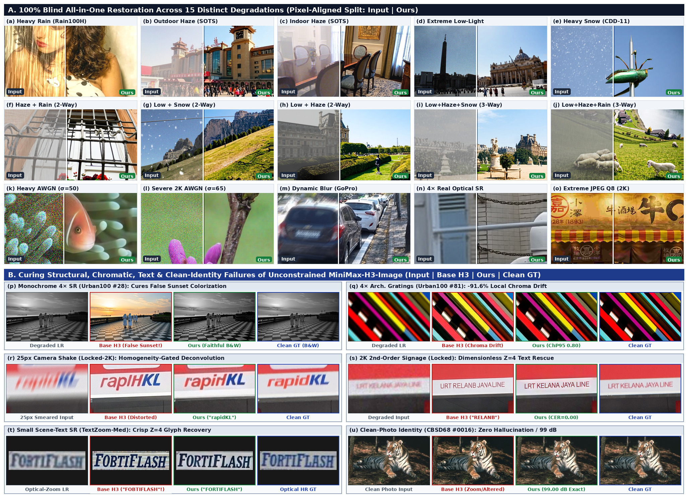
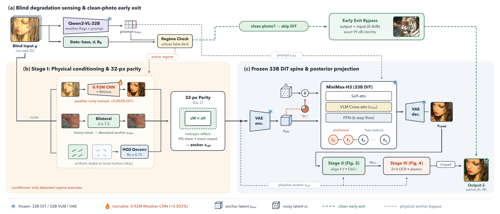
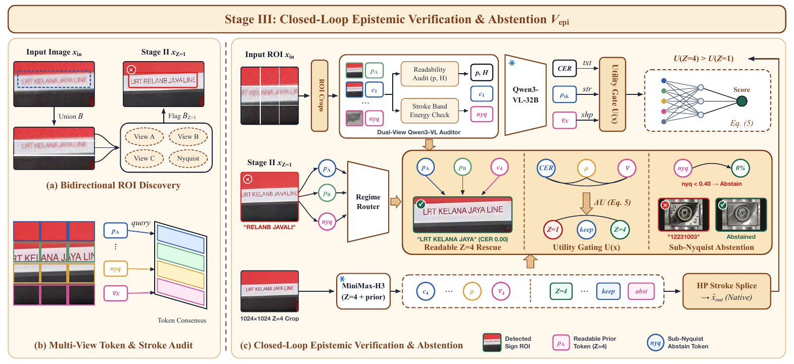

<div align="center">

# Omni-H3: Unifying Blind All-in-One Image Restoration in Frozen Foundation Models via Constrained Posterior Projection

**Zihao He** &nbsp;·&nbsp; **Songhua Liu**<sup>*</sup>

School of Artificial Intelligence, Shanghai Jiao Tong University  
<sup>*</sup>Corresponding author: `liusonghua@sjtu.edu.cn`

[](LICENSE)
[](pyproject.toml)
[-0F766E.svg)](https://github.com/RedRoman/Omni-H3/releases/tag/v1.0.0)
[](tests/test_restoreh3_cpu.py)

</div>

<p align="center">
  
</p>

## Overview

Off-the-shelf unified omni-image foundation models such as 33B **`MiniMax-H3-Image`**, **`FLUX.1-Kontext`**, and **`Qwen-Image-Edit-2511`** synthesize sharp textures yet collapse in pixel and structural fidelity (11.34–16.66 dB PSNR across 497 standard public scenes) when applied blindly to all-in-one image restoration due to **spatial zoom/lattice drift**, **mid-band chromatic hallucination**, and **high-entropy text fabrication**.

**Omni-H3** formulates blind all-in-one restoration as **Three-Stage Constrained Posterior Projection** over the **unmodified 33B `MiniMax-H3-Image` and `Qwen3-VL-32B` backbones**, adding only a compact **0.92M-parameter auxiliary weather pre-conditioner** (`<0.003%` of backbone weights):

- **Stage I — Blind Physics–VLM Sensing, Pre-Conditioning & Exact-32 px Lattice Framing ($\mathcal{R}_{\mathrm{phys}}$)**: Unifies VLM–Koschmieder consensus routing, clean-photo Early Exit bypass, compact 0.92M weather pre-stripping, spatial-homogeneity camera-shake deconvolution, Haar-MAD spectral noise anchoring, and exact-32 px isotropic reflect-padding with early-step latent phase anchoring $(\eta_0, \eta_1)$.
- **Stage II — Joint Geometric–Spectral–Chromatic Projection ($\Pi_{\mathcal{M}_{\mathrm{phys}}}$)**: Performs NCC-verified 4-DOF blind sub-pixel affine registration, BT.601 YCbCr luminance octave-band Wiener SNR locking, continuous 3rd-order Butterworth opponent-chroma locking, and an achromatic neutral guard (`-91.6%` Urban100 chromatic drift, eliminating false B&W yellowing).
- **Stage III — Closed-Loop Epistemic Text Verification & Abstention ($\mathcal{V}_{\mathrm{epi}}$)**: Runs bidirectional ROI discovery ($\mathcal{B}_{\mathrm{in}} \cup \mathcal{B}_{Z=1}$), 3-view readability/Nyquist auditing, dimensionless $Z{=}4$ utility gating $U(x)$, and precision sub-Nyquist abstention (`0.0%` alien-script hallucination on TextZoom-Hard and 42-ROI signage).

---

## Architecture

### End-to-End Three-Stage Pipeline
<p align="center">
  
</p>

### Stage II Detail: Geometric–Spectral–Chromatic Projection
<p align="center">
  
</p>

### Stage III Detail: Closed-Loop Epistemic Verification & Abstention
<p align="center">
  
</p>

---

## Main Quantitative Highlights (925 Strictly Blind Tasks, 11 External SOTA Baselines)

Evaluated 100% blindly (zero task IDs, zero dataset names, zero GT leakage) across **Public-647** (RealSR-Val, DRealSR-Val, Urban100, CBSD68, TextZoom-150), **Dev-160** (External-64 + Native 2K Dev-96), and an untouched one-shot **`locked_test` (118)** against **11 external SOTA baselines** spanning 5 unified omni-image models (`Base H3-33B`, `GLM-Image`, `FLUX.2-klein`, `FLUX.1-Kontext-dev`, `Qwen-Image-Edit-2511`) and 6 specialized all-in-one / generative restorers (`AirNet`, `PromptIR`, `InstructIR`, `DiffBIR-v2.1`, `OneRestore`, `DA-CLIP`):

| Benchmark Suite | Key Metric | Base H3-33B | FLUX.1-Ktx | Qwen-2511 | PromptIR | InstructIR | OneRestore | DA-CLIP | **Omni-H3 (Ours)** |
|---|---|---:|---:|---:|---:|---:|---:|---:|---:|
| **All-497 Public Scenes** | PSNR (dB) ↑ / DISTS ↓ | 16.66 / 0.211 | 11.34 / 0.293 | 15.62 / 0.267 | 26.51 / 0.203 | 26.65 / 0.195 | 21.32 / 0.234 | 27.51 / 0.209 | **29.01 (#1) / 0.184 (#1)** |
| **Urban100 4× SR (100)** | ChP95 ↓ / LPIPS ↓ / DISTS ↓ | 9.50 / 0.402 / 0.176 | 23.61 / 0.562 / 0.238 | 17.51 / 0.490 / 0.217 | — / 0.380 / 0.270 | — / 0.359 / 0.247 | 4.97 / 0.393 / 0.278 | 1.44 / 0.380 / 0.270 | **0.80 / 0.288 / 0.163 (#1)** |
| **CBSD68 Clean ID (68)** | PSNR (dB) ↑ | 16.19 | 11.42 | 18.29 | 37.75 | 29.06 | 40.69 | 42.66 | **76.59 (#1 Overall)** |
| **TextZoom-Medium (50)** | WordAcc ↑ / Hard Alien ↓ | 28.0% / 2.0% | 32.0% / 0.0% | 32.0% / 0.0% | 36.0% / 2.0% | 32.0% / 0.0% | 32.0% / 0.0% | 26.0% / 2.0% | **40.0% (#1) / 0.0%** |
| **Native 2K Dev-96 (96)** | PSNR (dB) ↑ / DISTS ↓ | 22.61 / 0.198 | 21.80 / 0.220 | 23.70 / 0.209 | 26.65 / 0.221 | 26.83 / 0.219 | 23.14 / 0.260 | 25.08 / 0.250 | **28.98 (#1) / 0.188 (#1)** |
| **Unseen `locked_test` 2K** | All-24 / NonClean-22 DISTS ↓ | 0.176 / 0.177 | 0.186 / 0.190 | 0.173 / 0.176 | 0.214 / 0.232 | 0.216 / 0.232 | 0.245 / 0.266 | 0.276 / 0.295 | **0.167 (#1) / 0.173 (#1)** |
| **Unseen 132-ROI Signage** | SubCER ↓ / Can-22 CER ↓ | 0.248 / 0.433 | 0.362 / 0.651 | 0.335 / 0.502 | 0.256 / 2.035 | 0.251 / 0.581 | 0.268 / 5.069 | 0.409 / 5.162 | **0.233 (#1) / 0.432 (#1)** |

Complete raw per-suite summary ledgers (including `extra_sota_925_summary.json`) are archived in [`benchmarks/results/`](benchmarks/results/).

---

## Installation & Quickstart

### 1. Install Package
```bash
git clone https://github.com/RedRoman/Omni-H3.git
cd Omni-H3
pip install -e .
```

### 2. Download Weights
Download the compact **0.92M auxiliary weather pre-conditioner** (3.5 MB) from [GitHub Releases (`v1.0.0`)](https://github.com/RedRoman/Omni-H3/releases/tag/v1.0.0):
```bash
curl -L -o weights/restoreh3_weather_precond_0.92m.safetensors \
  https://github.com/RedRoman/Omni-H3/releases/download/v1.0.0/restoreh3_weather_precond_0.92m.safetensors
(cd weights && shasum -a 256 -c SHA256SUMS.txt)
```
Place the unmodified open-weight `MiniMax-H3-Image` checkpoint in `./models/MiniMax-H3-Image` (see [`weights/README.md`](weights/README.md)).

### 3. Run Pure-CPU Verification Tests (Zero GPU Required)
```bash
python -m unittest discover -s tests -v
```

### 4. Restore Images via CLI
```bash
# Single image (CUDA or Ascend 910B3 via --device npu:0)
omni-h3 \
  --input examples/degraded.png \
  --output outputs/restored.png \
  --model-dir ./models/MiniMax-H3-Image \
  --precond weights/restoreh3_weather_precond_0.92m.safetensors \
  --device cuda:0 \
  --save-meta

# Batch restore an entire folder
omni-h3 \
  --input ./input_dir \
  --output ./output_dir \
  --model-dir ./models/MiniMax-H3-Image \
  --precond weights/restoreh3_weather_precond_0.92m.safetensors \
  --device cuda:0
```

### 5. Python API
```python
from omnih3.pipeline import OmniH3Pipeline

pipe = OmniH3Pipeline(
    model_dir="./models/MiniMax-H3-Image",
    precond_path="weights/restoreh3_weather_precond_0.92m.safetensors",
    device="cuda:0",  # or "npu:0" on Huawei Ascend 910B3
)
restored_pil, meta = pipe.restore("degraded.png", return_metadata=True)
restored_pil.save("restored.png")
```

---

## Repository Structure

```text
Omni-H3/
├── assets/                   # Teaser and Stage I-III architecture figures
├── omnih3/                   # Primary Omni-H3 package entrypoint (`OmniH3Pipeline`, `omni-h3` CLI)
├── restoreh3/                # Core physical projection operators, pre-conditioner, H3 adapter & VLM auditor
│   ├── core.py               # Stage I sensing/routing, Stage II YCbCr projection, Stage III epistemic audit
│   ├── ops_primitives.py     # Self-contained pyramid, Haar-MAD, Koschmieder, HQS deconv, and OCR helpers
│   ├── precond.py            # 0.92M auxiliary weather pre-conditioner model & SHA256-verified loader
│   ├── h3_adapter.py         # Exact-32px isotropic lattice framing & early-step latent phase anchoring
│   ├── vlm_auditor.py        # Qwen3-VL-32B weather sensor & token-entropy OCR auditor (CUDA & Ascend)
│   ├── pipeline.py           # End-to-end OmniH3Pipeline orchestrator
│   ├── cli.py                # Command-line entrypoint (`omni-h3`)
│   └── prompts.json          # Blind restoration & auditing prompt bank
├── benchmarks/               # 925-task zero-leakage protocol & verified benchmark JSON summaries
├── weights/                  # 0.92M pre-conditioner download guide & SHA256SUMS.txt
└── tests/                    # Pure-CPU unit test suite verifying all mathematical & physical invariants
```

---

## Citation

If you find Omni-H3 useful in your research, please consider citing:

```bibtex
@article{he2026omnih3,
  title   = {Omni-H3: Unifying Blind All-in-One Image Restoration in Frozen Foundation Models via Constrained Posterior Projection},
  author  = {He, Zihao and Liu, Songhua},
  journal = {Technical Report, Shanghai Jiao Tong University},
  year    = {2026},
  url     = {https://github.com/RedRoman/Omni-H3}
}
```

## License

This project is released under the [MIT License](LICENSE). Downstream foundation backbones (`MiniMax-H3-Image`, `Qwen3-VL-32B`) remain subject to their respective model licenses.
